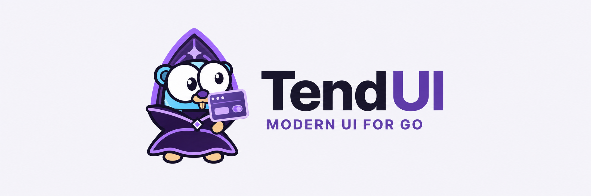

<picture>
  <source media="(prefers-color-scheme: dark)" srcset="docs/brand/readme-banner-dark.png">
  
</picture>

# Beautiful interfaces. No build pipeline.

Pure CSS. Semantic HTML. **No Node.js, no npm, no bundled JavaScript.**
First-class Go and templ support, with styles embedded directly in your binary.

[Documentation](https://tendui.com/docs) · [Component catalog](https://tendui.com/catalog) · [Playground](https://tendui.com/playground) · [Examples](https://tendui.com/examples)

## Small pieces. A complete starting point.

| Build with | What you get |
| --- | --- |
| **Any HTML stack** | One semantic stylesheet for native elements, forms, cards and layouts. |
| **Go** | Embedded assets and a standard-library HTTP handler. Build and ship one executable. |
| **templ** | Typed component props and composable content slots; generated Go ships with the module. |
| **Optional HTMX** | Explicit request attributes and page/fragment helpers. Your app supplies the runtime. |

Light, dark and system themes. Responsive layouts. Configurable spacing and
surfaces. Native interactions, keyboard access and bounded CSS motion.

## Get a page running

Use **Go 1.26+** and the pinned preview:

```sh
go get github.com/Tend-Stack/TendUI/v2026@v2026.2.0-preview.2
```

The asset package uses only Go's standard library. Components use **templ
v0.3.1100** as their one direct runtime dependency. No generator is required to
consume the included components from Go; writing your own `.templ` files needs
the matching templ generator.

```go
package main

import (
    "log"
    "net/http"

    "github.com/Tend-Stack/TendUI/v2026"
    "github.com/Tend-Stack/TendUI/v2026/components"
    "github.com/a-h/templ"
)

func main() {
    mux := http.NewServeMux()
    mux.Handle(tendui.AssetPath, tendui.AssetHandler())
    page := components.Layout(components.LayoutProps{
        Title: "Hello, TendUI", Language: "en", Theme: components.ThemeLight,
    }, components.Card(components.CardProps{
        Body: components.Button(components.ButtonProps{
            Text: "Build something thoughtful", Primary: true,
        }),
    }))
    mux.Handle("/", templ.Handler(page))
    log.Fatal(http.ListenAndServe("127.0.0.1:8080", mux))
}
```

Follow the [tested Go/templ quickstart](docs/quickstart.md), use
[Go html/template](examples/htmltemplate) with embedded CSS and no templ components,
or start with [plain HTML and CSS](examples/html) with no Go dependency. Run the full local
showcase with `go run ./examples/basic -open`.

## Explore your next step

| I want to… | Start here |
| --- | --- |
| Find a component and copy a recipe | [Live catalog](https://tendui.com/catalog) |
| Customize themes, forms and layouts | [Library guide](docs/library-guide.md) |
| Test interactions and appearance | [Playground](https://tendui.com/playground) · [Motion and surfaces](https://tendui.com/motion) |
| Work with Codex or Claude Code | [Agent setup](docs/agents.md) |
| Add TendUI to an application | [Integration guide](docs/tendui-migration.md) |
| Understand compatibility and verification | [API policy](docs/api-compatibility.md) · [Development guide](docs/development.md) |

## Preview, with clear boundaries

This is a preview; APIs may change before a stable release. Install a fixed
version and review [release notes](docs/releases/2026.2.0-preview.2.md) when
upgrading. Versions follow `YEAR.RELEASE.FIX`, with `-preview.N` for previews.
The Go module uses `/v2026` for the 2026 major-version line.

Your application owns routing, authentication, request protection, persistence
and sessions. HTMX is optional and requires application-supplied JavaScript.

## Build with us

Contributions are welcome under **MIT + DCO**. Contributors retain copyright;
a human reviews and signs off every contribution. Start with
[CONTRIBUTING.md](CONTRIBUTING.md), [open issues](https://github.com/Tend-Stack/TendUI/issues),
or the [coding-agent instructions](AGENTS.md). `CLAUDE.md` imports the same guidance.

[Security reports](SECURITY.md) · [Code of conduct](CODE_OF_CONDUCT.md) · [MIT license](LICENSE) · [Website source](https://github.com/Tend-Stack/TendUI-web)
